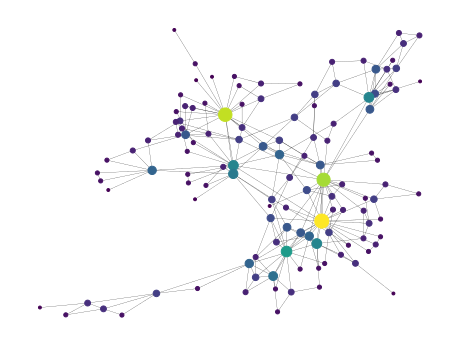

orgroamtools documentation
========================================

``orgroamtools`` is a work-in-progress replication of ``obsidiantools``--a Python library to assist in data analysis of Obsidian collections--but for ``org-roam`` collections.

===============
Getting Started
===============
Install with ``pip install orgroamtools``.

Ensure your ``org-roam v2`` database is up-to-date by running ``(org-roam-db-sync)`` inside Emacs. Locate your database by checking the value of ``(org-roam-db-location)``.
Once you've imported the ``RoamGraph`` object, you can load your collection::

  from orgroamtools.data import RoamGraph

  collection = RoamGraph(PATH_TO_DB)

-------------
Data Provided
-------------
The central object is the ``RoamGraph`` object, which stores a collection of ``RoamNode`` objects and the graph structure they create via backlinks.
The data contained in the ``RoamNode`` includes its ``ID`` given by ``org-mode``, its title, the file it resides in, the org-tags it has, its list of backlinks to other nodes, and the list of other org-links that are not backlinks.

-------
Indices
-------
An *index* refers to an object of type ``dict[str, T]`` where the keys are IDs of nodes and ``T`` is some information about the node with the associated ID.
The library provides several indices:

- ``node_index``: ``T`` is the ``RoamNode`` of the node with corresponding ID

- ``title_index``: ``T`` is the title of the node

- ``tag_index``: ``T`` is the set of tags a node has

- ``backlink_index``: ``T`` is the list of backlinks to other nodes in the node

- ``file_index``: ``T`` is the filename where the node is located

- ``misc_link_index``: ``T`` is a list of other org-links that are not backlinks. e.g. links to files, websites, etc

- Indices extracting from the body text of the node:

  - ``body_index`` : ``T`` is the body of the node: its text and that of its
    subheadings (with their heading lines), without its own heading line,
    property drawer, or a file's ``#+title:``/``#+filetags:`` lines. Links are
    shown as their descriptions. Files are read when the index is requested and
    cached until they change on disk.

  - ``math_snippet_index`` : ``T`` is a list of LaTeX math snippets inside the
    node, in document order and with surrounding whitespace removed

    - Supported delimiters: ``\(...\)``, ``\[...\]``, ``$...$``, ``$$...$$``;
      the environments ``equation``, ``align``, ``gather``, ``multline``,
      ``flalign``, ``eqnarray``, ``math`` and ``displaymath`` (each optionally
      starred); and ``#+begin_equation`` / ``#+begin_latex`` blocks. Text
      inside source blocks is ignored.

  - ``src_block_index`` : ``T`` is a list of tuples ``(S,W)`` where ``S`` is the
    language of the source block (``None`` if not given) and ``W`` is its content

For example, a node whose body is::

    Since $e^{i\pi} = -1$, we have
    \begin{equation*}
    e^{2i\pi} = 1
    \end{equation*}
    It costs $5 and $6.

has ``math_snippet_index`` entry ``["e^{i\pi} = -1", "e^{2i\pi} = 1"]``.

As an example of how to use these indices, let's make our own ``backlink_index`` but instead of using lists of org IDs for the backlink lists, we'll make them the title of the nodes.
The ``title_index`` property provides a mapping from ``ID -> title``, so we could make it a simple one-liner::

  net = RoamGraph(PATH_TO_DB)
  backlink_index_titles = {node.id : [net.title_index[ID]
                            for ID in node.backlinks] for node in net.nodes}

---------------
NetworkX Graph
---------------

The ``RoamGraph`` object also provides a ``networkx.MultiDiGraph`` representation of the network. The ``networkx`` library is very feature-rich for graph manipulations, and can be used to create nice visualization such as this:

------------------------------
Manipulation of the Collection
------------------------------

In addition to this information, primitive manipulations of the collection are
provided, such as filtering the collection by tag
(:func:`orgroamtools.data.RoamGraph.filter_tags`) and removal of orphans
(:func:`orgroamtools.data.RoamGraph.remove_orphans`). Both return a new
``RoamGraph`` and leave the original unchanged.

For other manipulations, build a new node index and assign it to
:attr:`orgroamtools.data.RoamGraph.node_index`. The graph, the indices, and the
list of orphans are recomputed automatically, and links to nodes that are no
longer present are dropped.

For example, to remove the node with ID ``foo`` from a collection ``bar``::

    bar.node_index = {ID: node for ID, node in bar.node_index.items() if ID != "foo"}

Links to ``foo`` from the remaining nodes are removed by the assignment.
Calling ``refresh()`` is no longer necessary and is deprecated.

-------------
General Notes
-------------
Because ``org-roam`` allows you to have multiple nodes with the same title, the ID of a node is guaranteed to uniquely identify a node in your collection.
For user ergonomics, you are permitted to identify nodes by their title.
For example, in the :func:`orgroamtools.data.RoamGraph.node` function, the ``identifier`` argument can be either a node title or node ID.
If no node matches an identifier, :exc:`orgroamtools._utils.NodeNotFoundError`
(a ``KeyError``) is raised.
If the network detects multiple nodes with the same title and you attempt to identify a node by the duplicated title, you will be warned that it might not be the output you wanted.

If a node's file has been deleted or edited since the database was last
synced, its body is returned as ``""`` with a
:exc:`orgroamtools._utils.BodyNotFoundWarning`. Run
``(org-roam-db-sync)`` to refresh the database.

.. toctree::
   :maxdepth: 3
   :caption: Contents:

   orgroamtools

Indices and tables
==================

* :ref:`genindex`
* :ref:`search`
